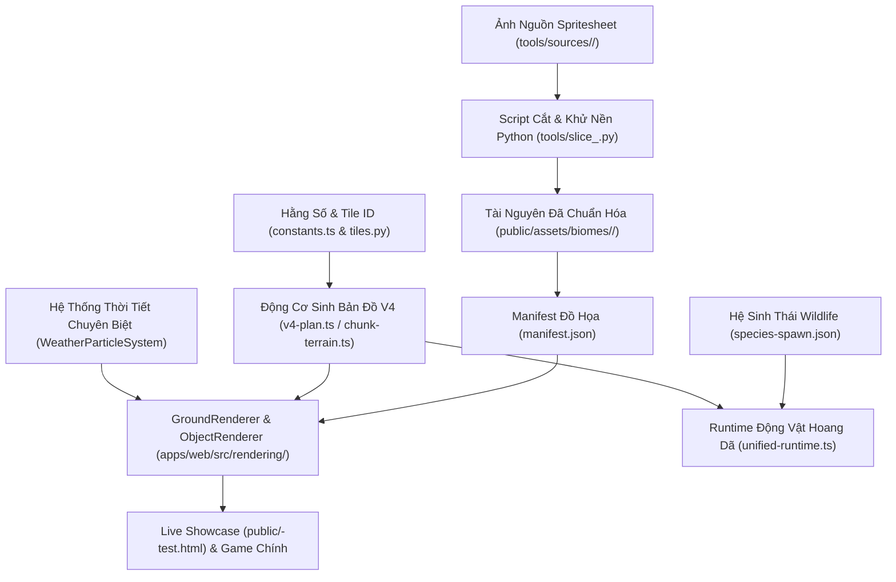

# PokeOverworld — Hướng Dẫn Toàn Diện Quy Trình Triển Khai Biome Mới
# (Comprehensive Guide to Implementing a New Biome)

> **Tài liệu chuẩn mực**: Quy trình chuẩn hóa từng bước (End-to-End Workflow) để tích hợp một Biome mới vào thế giới mở Overworld, đúc kết từ kinh nghiệm thực tiễn triển khai **Biome Rừng Mùa Thu (`autumn`)** và **Biome Băng Tuyết (`snow`)**.
> **Áp dụng cho**: Lập trình viên, Nhà thiết kế bản đồ & Kỹ sư đồ họa Game.

---

## 🗺️ Mục Lục
1. [Tổng Quan Kiến Trúc Đa Tầng Của Một Biome](#1-tổng-quan-kiến-trúc-đa-tầng-của-một-biome)
2. [Bước 1: Bóc Tách & Chuẩn Hóa Tài Nguyên Đồ Họa (Asset Slicing Pipeline)](#bước-1-bóc-tách--chuẩn-hóa-tài-nguyên-đồ-họa-asset-slicing-pipeline)
3. [Bước 2: Định Danh Tile ID & Đồng Bộ Đa Ngôn Ngữ (Constants & Parity)](#bước-2-định-danh-tile-id--đồng-bộ-đa-ngôn-ngữ-constants--parity)
4. [Bước 3: Thuật Toán Autotile 3×3 & Sinh Địa Hình Thủ Tục (World Generation)](#bước-3-thuật-toán-autotile-33--sinh-địa-hình-thủ-tục-world-generation)
5. [Bước 4: Kết Xuất Đồ Họa & Hoạt Ảnh 60 FPS (Rendering & Animation)](#bước-4-kết-xuất-đồ-họa--hoạt-ảnh-60-fps-rendering--animation)
6. [Bước 5: Hệ Thống Thời Tiết & Hạt Chuyên Biệt (Weather & Particles)](#bước-5-hệ-thống-thời-tiết--hạt-chuyên-biệt-weather--particles)
7. [Bước 6: Tích Hợp Hệ Sinh Thái & Pokémon Hoang Dã (Wildlife Ecology)](#bước-6-tích-hợp-hệ-sinh-thái--pokémon-hoang-dã-wildlife-ecology)
8. [Bước 7: Xây Dựng Trang Trải Nghiệm Showcase & Bộ Kiểm Thử (QA & Testing)](#bước-7-xây-dựng-trang-trải-nghiệm-showcase--bộ-kiểm-thử-qa--testing)
9. [Bảng Kiểm Định Bắt Buộc (Checklist Trước Khi Push Git)](#bảng-kiểm-định-bắt-buộc-checklist-trước-khi-push-git)

---

## 1. Tổng Quan Kiến Trúc Đa Tầng Của Một Biome

Một Biome hoàn chỉnh trong PokeOverworld không chỉ đơn thuần là thay đổi màu đất, mà là một hệ sinh thái sống động vận hành đồng bộ qua 6 tầng kiến trúc:



---

## Bước 1: Bóc Tách & Chuẩn Hóa Tài Nguyên Đồ Họa (Asset Slicing Pipeline)

### 1.1. Lưu trữ ảnh gốc
- Lưu toàn bộ spritesheet gốc người dùng cung cấp vào thư mục: `tools/sources/<biome_name>/`.
- **Tuyệt đối không xóa thư mục `tools/sources/`** vì đây là kho tư liệu gốc để tái tạo khi cần chỉnh sửa.

### 1.2. Quy tắc vàng bóc tách nền đất (`ground_<biome>_pure`)
> [!IMPORTANT]
> **Quy tắc trích xuất màu nền đất:**
> Nền đất thuần của biome **bắt buộc phải lấy từ tâm đỉnh đồi cao (plateau interior)** của biome đó, ví dụ tọa độ `(32, 32)` đến `(64, 64)` của khối đồi cao nguyên. Điều này đảm bảo màu nền đất phẳng khớp tuyệt đối 100% với màu đất trên đỉnh đồi, triệt tiêu hoàn toàn hiện tượng lệch tông màu.

### 1.3. Danh sách các tài nguyên chuẩn cần trích xuất cho mỗi Biome:

| Phân Loại | Số Lượng Chuẩn | Tên Khóa Đồ Họa | Quy Cách Kích Thước | Ghi Chú Kỹ Thuật |
| :--- | :---: | :--- | :---: | :--- |
| **Nền Đất Thuần** | 1 | `ground_<biome>_pure` | 32×32 | Lặp lại liền mạch (seamless tiling) |
| **Cỏ Ranh Giới (Fringe)** | 12 | `ground_<biome>_{top,bot,left,right,tl,tr,bl,br,in_tl,in_tr,in_bl,in_br}` | 32×32 | Giữ nguyên độ trong suốt (alpha transparency) viền ngoài để đè lên cỏ đồng bằng |
| **Đồi Cao / Vách Núi** | 13 | `cliff_<biome>_{pure,top,bot,left,right,tl,tr,bl,br,in_tl,in_tr,in_bl,in_br}` | 32×32 | 3×3 vách ngoài + 4 góc khuyết lõm trong (`in_*`). Tấm bổ sung đường cong dùng để ghép vào góc lõm, không phải landmark |
| **Cỏ Cao Lội Chân** | 2 | `tall_grass_<biome>` & `tall_grass_<biome>_strip` | 32×32 & 160×32 | Dải 5 khung hình (1 frame tĩnh + 4 frame đung đưa), có ngọn lá che chân nhân vật |
| **Cây Cối Lớn** | 4 – 8 | `tree_<biome>_*` | 64×128 (hoặc 64×64) | Khử sạch nền trắng/đen. Chân gốc căn tại đáy, neo tọa độ `[w/2, h - 8]` |
| **Bụi Cây & Thực Vật** | 6 – 10 | `bush_<biome>_*`, `flora_<biome>_*` | 32×64 hoặc 64×64 | Phân rõ bụi cây có va chạm (solid) và hoa/cỏ thấp không va chạm |
| **Decal Mặt Đất** | 8 – 16 | `decor_<biome>_*` | 32×32 | Đốm nứt, mảng tuyết/lá rụng, sỏi đá nhỏ. Nướng thẳng xuống Layer 0, **không có hitbox** |
| **Mặt Nước Chuyên Biệt** | 14 | `water_<biome>_*` | 128×32 | Dải 4 khung hình hoạt họa sóng (tâm nước, 8 bờ đất biome, 4 góc lõm nội suy bán kính $R=20\text{px}$, 1 khúc uốn sông) |
| **Hạt Thời Tiết** | 4 | `<weather>_{1..4}` | 16×16 (hoặc vệt mưa) | Bộ hạt pixel chuẩn cho các mức cường độ thời tiết |

### 1.4. Đăng ký Manifest tự động
Sau khi cắt, viết script (hoặc dùng Python `json.dump`) đăng ký toàn bộ vào [`apps/web/public/assets/manifest.json`](file:///e:/Pokemon/apps/web/public/assets/manifest.json). Đường dẫn asset phải trỏ đúng thư mục con mô-đun: `/assets/biomes/<biome_name>/<key>.png`.

---

## Bước 2: Định Danh Tile ID & Đồng Bộ Đa Ngôn Ngữ (Constants & Parity)

Hệ thống yêu cầu sự đồng bộ 100% giữa TypeScript và Python để phục vụ cả Web Engine lẫn Generator backend.

### 2.1. Cập nhật TypeScript ([`packages/game-data/constants.ts`](file:///e:/Pokemon/packages/game-data/constants.ts))
1. Thêm định danh địa hình:
   ```typescript
   export const TERRAIN = {
     // ... các terrain cũ
     SNOW: 9, // hoặc BIOME_NAME mới
   } as const;
   ```
2. Cấp phát dải Tile ID (mỗi biome một dải riêng, ví dụ Snow: 510..562 & 770..783):
   ```typescript
   export const TILE_IDS = {
     // Nền đất ranh giới: 510..522
     ground_snow_pure: 510,
     ground_snow_top: 511,
     // ...
     // Vách núi đồi cao: 530..542
     cliff_snow_pure: 530,
     // ...
     // Nước hồ hoạt họa: 770..783
     water_snow_pure: 770,
     // ...
   } as const;
   ```
3. Cập nhật các hàm predicate:
   - `isWaterTile(tileId)`: Bổ sung dải ID nước mới.
   - `is<Biome>Tile(tileId)`: Nhận diện toàn bộ các Tile ID thuộc biome.

### 2.2. Đồng bộ Python ([`map_generator/tiles.py`](file:///e:/Pokemon/map_generator/tiles.py))
- Sao chép chính xác từng cặp key-value của `TILE_IDS` vừa thêm sang từ điển `TILE_IDS = { ... }` trong Python.

### 2.3. Ánh xạ Đồ họa ([`apps/web/src/rendering/types.ts`](file:///e:/Pokemon/apps/web/src/rendering/types.ts))
- Thêm từng Tile ID vào bảng tra cứu `TILE_KEY_BY_ID`:
   ```typescript
   [TILE_IDS.ground_snow_pure]: 'ground_snow_pure',
   [TILE_IDS.water_snow_pure]: 'water_snow_pure',
   ```

---

## Bước 3: Thuật Toán Autotile 3×3 & Sinh Địa Hình Thủ Tục (World Generation)

### 3.1. Cấu hình Mặt Nạ Nhiễu (Noise Mask)
Trong [`apps/web/src/maps/terrain-field/v4-plan.ts`](file:///e:/Pokemon/apps/web/src/maps/terrain-field/v4-plan.ts):
- Sử dụng thuật toán Simplex/Perlin noise kết hợp kiểm tra khoảng cách đến làng khởi đầu (Spawn isolation) để tạo các vùng lục địa tự nhiên:
  ```typescript
  const SNOW_SCALE = 180;
  const SNOW_THRESHOLD = 0.62;
  // Đảm bảo không ghi đè vào đại dương (isOcean) hoặc làng khởi đầu
  ```
- Expose hàm `is<Biome>(gx: number, gy: number): boolean` trên `TerrainField` interface.

### 3.2. Thuật toán Autotile 3×3 ([`apps/web/src/maps/autotile.ts`](file:///e:/Pokemon/apps/web/src/maps/autotile.ts))
Xây dựng hàm phân giải kết nối 8 hướng (N, S, W, E, NW, NE, SW, SE) cho:
1. `get<Biome>GroundTileKey`: Nối ranh giới cỏ tự nhiên ra cỏ meadow.
2. `get<Biome>CliffTileKey`: Nối 13 ô vách núi đồi cao.
3. `autotileWater`: Khi `field.is<Biome>(gx, gy)` là `true`, tự động chuyển sang dải `water_<biome>_*`.

### 3.3. Phân bổ thực thể & Chống lỗi Decal ([`apps/web/src/maps/chunk-objects.ts`](file:///e:/Pokemon/apps/web/src/maps/chunk-objects.ts))
> [!CAUTION]
> **Quy tắc đặt Decal và Chướng ngại vật:**
> 1. Decal mặt đất (`decor_*`) **chỉ được phép sinh trên nền đất thuần (`ground_<biome>_pure`)**. Tuyệt đối không sinh đè lên cỏ ranh giới (fringe) hay vách núi để tránh lỗi rách đồ họa.
> 2. Decal mặt đất phải đặt `isDecal = true` và nướng vào Layer 0 (không cấp phát hitbox collider).
> 3. Cây lớn và bụi rậm phải kiểm tra vùng trống 2×2 ô để không bị chồng lấn vào nhau.

---

## Bước 4: Kết Xuất Đồ Họa & Hoạt Ảnh 60 FPS (Rendering & Animation)

### 4.1. Nướng Nền Đất Chunk ([`apps/web/src/rendering/ground-renderer.ts`](file:///e:/Pokemon/apps/web/src/rendering/ground-renderer.ts))
- Các ô đất tĩnh và decal được vẽ 1 lần duy nhất lên `OffscreenCanvas` của chunk (dung lượng LRU 96 chunk).
- Đối với ô nước chuyên biệt (`water_<biome>_*`), gọi `gCtx.clearRect(...)` để làm rỗng ô đất, nhường chỗ cho lớp nước động chạy bên dưới.

### 4.2. Hoạt Ảnh Nước Động 4 Khung Hình
- Trong vòng lặp `renderWaterTiles()`:
  ```typescript
  const waterFrame = Math.floor((performance.now() / 280) % 4);
  const sx = waterFrame * 32;
  // Vẽ trực tiếp từ dải 128x32 với sx tương ứng
  ctx.drawImage(imgStrip, sx, 0, 32, 32, px, py, 32, 32);
  ```

### 4.3. Sắp xếp chiều sâu 2.5D ([`apps/web/src/rendering/object-renderer.ts`](file:///e:/Pokemon/apps/web/src/rendering/object-renderer.ts))
- Mọi cây cối, tảng đá lớn, và Pokémon được sắp xếp theo tọa độ `ySort = chân thực thể`.
- Khi nhân vật bước vào ô cỏ cao của biome (`tg.is<Biome>`), sử dụng đúng dải hoạt họa cỏ cao của biome đó (`tall_grass_<biome>_strip`) để tạo hiệu ứng lội cỏ che chân.

---

## Bước 5: Hệ Thống Thời Tiết & Hạt Chuyên Biệt (Weather & Particles)

Tạo hệ thống thời tiết chuyên biệt tại `apps/web/src/rendering/weather/` (ví dụ [`snow-particle-system.ts`](file:///e:/Pokemon/apps/web/src/rendering/weather/snow-particle-system.ts)):

1. **Nguyên tắc "Luôn có khi ở trong Biome"**:
   - Khi nhân vật bước vào Biome, dù thời tiết toàn thế giới là trời quang (`clear`), hiệu ứng hạt đặc trưng (ví dụ tuyết rơi nhẹ) **luôn luôn kích hoạt**.
2. **Thiết kế đa mức độ (Multi-Tier Intensity)**:
   - **Mức 1 (Bình thường)**: Hạt rơi êm dịu, số lượng vừa phải (~60 hạt), chuyển động hình sin nhẹ.
   - **Mức 2 (Bão / Gió mạnh)**: Tăng mật độ hạt gấp 2.5 lần (~150 hạt), vận tốc bay nhanh gấp đôi, có luồng gió giật.
   - **Mức 3 (Cuồng nộ)**: Tối đa hạt (~240 hạt), góc bay xéo cực đại, kết hợp lớp sương mù quang học mờ ảo (`rgba`).
3. **Hiệu suất Zero GC**:
   - Khởi tạo trước một mảng hạt tĩnh, chỉ cập nhật vị trí `x, y, angle` trong vòng lặp `update()`, tuyệt đối không tạo mới object trong `render()`.

---

## Bước 6: Tích Hợp Hệ Sinh Thái & Pokémon Hoang Dã (Wildlife Ecology)

1. **Phân Giải Biome Runtime ([`apps/web/src/maps/ecology/biome-resolver.ts`](file:///e:/Pokemon/apps/web/src/maps/ecology/biome-resolver.ts))**:
   - Thêm nhánh ưu tiên: `if (field.is<Biome>?.(gx, gy)) return '<biome_id>';`.
2. **Cấu Hình Ngân Sách Chunk ([`packages/game-data/wildlife/spawn-config.json`](file:///e:/Pokemon/packages/game-data/wildlife/spawn-config.json))**:
   - Khai báo số lượng bầy đàn cho biome mới: `"<biome_id>": [2, 4]`.
3. **Mở Khóa Môi Trường Sống ([`packages/game-data/wildlife/species-spawn.json`](file:///e:/Pokemon/packages/game-data/wildlife/species-spawn.json))**:
   - Phân bổ các loài Pokémon Gen 1 phù hợp vào biome mới với các ngữ cảnh sinh thái (`walkable_ground`, `tall_grass`, `water_surface`).
4. **Bản Đồ Toàn Cảnh & Mini-map**:
   - Cập nhật mã màu pixel trong [`world-map-palette.ts`](file:///e:/Pokemon/apps/web/src/ui/world-map/world-map-palette.ts).
   - Thêm nhãn tên tiếng Việt trên màn hình World Map (`world-map-screen.ts`) và Mini-map HUD (`minimap-renderer.ts`).

---

## Bước 7: Xây Dựng Trang Trải Nghiệm Showcase & Bộ Kiểm Thử (QA & Testing)

### 7.1. Trang Showcase Tương Tác ([`public/<biome>-test.html`](file:///e:/Pokemon/apps/web/public/snow-biome-test.html))
Tạo script Python `tools/build_<biome>_test_page.py` sinh ra trang HTML kiểm thử độc lập gồm:
- **Tab 1: Live Simulator**:
  - Canvas tương tác 60 FPS hỗ trợ điều khiển nhân vật Red đi lại khám phá.
  - Bộ công cụ thanh công cụ: Thu phóng (1×, 2×, 3×), Thời khắc (Ngày / Hoàng hôn / Đêm), Thời tiết (các mức độ), Lưới ô cờ (Grid), Nút Re-roll ngẫu nhiên vị trí.
  - Công cụ **Thám tử ô đất (Tile Inspector)**: Rê chuột vào ô bất kỳ để đọc tọa độ, tên tile ID, loại Biome và thuộc tính vật thể.
- **Tab 2: Catalog Trực Quan**:
  - Hiển thị toàn bộ các thẻ tài nguyên phân theo danh mục, có ảnh thumb, kích thước pixel và tên tiếng Việt chuẩn.

### 7.2. Bộ Kiểm Thử Tự Động Vitest ([`apps/web/test/<biome>-biome.test.ts`](file:///e:/Pokemon/apps/web/test/snow-biome.test.ts))
Viết tối thiểu các bài test tự động bao quát:
- Tính tất định của hàm nhiễu địa hình sinh ra biome trên bản đồ lớn.
- Xác thực 100% tài nguyên đồ họa có mặt trên ổ đĩa và đã đăng ký trong `manifest.json`.
- Kiểm tra tính toán autotile kết nối 3×3 cho nền cỏ ranh giới, vách núi và mặt nước.
- Xác thực phân bổ Pokémon hoang dã và ngân sách spawn.

---

## Bảng Kiểm Định Bắt Buộc (Checklist Trước Khi Push Git)

Trước khi commit và đẩy code lên git, **bắt buộc chạy và đạt 100% PASS** 3 lệnh kiểm định sau:

```bash
# 1. Kiểm tra toàn diện Schema, Manifest và tính đồng bộ 100% giữa TypeScript & Python:
node scripts/validate-schemas.mjs

# 2. Kiểm tra tính toàn vẹn hệ sinh thái động vật hoang dã 151 loài Pokémon:
node scripts/validate-wildlife.mjs

# 3. Chạy toàn bộ bộ kiểm thử tự động của Biome:
npx vitest run test/<biome>-biome.test.ts
```

| Tiêu Chí Kiểm Tra | Kết Quả Đạt Chuẩn |
| :--- | :---: |
| **TypeScript Compilation** | 0 lỗi biên dịch (`npm run typecheck:web`) |
| **Tile ID TS & Python Parity** | Khớp 100% số lượng và giá trị ID giữa `constants.ts` và `tiles.py` |
| **Asset Manifest On-disk** | 100% file ảnh khai báo trong `manifest.json` tồn tại thực tế trên đĩa |
| **Seamless Seams** | Nền đất phẳng và đỉnh đồi khớp màu 100%, không bị vệt ranh giới gãy khúc |
| **Decal Integrity** | Decal chỉ xuất hiện trên đất thuần, không đè lên cỏ ranh giới |
| **Frame Rate** | Đạt 60 FPS ổn định, không cấp phát rác bộ nhớ (Zero GC) trong render loop |
