# HƯỚNG DẪN TRIỂN KHAI & PHÁT TRIỂN CỐT TRUYỆN (STORY SYSTEM DEVELOPER GUIDE)

> **Mục tiêu**: Cung cấp tài liệu quy chuẩn kỹ thuật, kiến trúc hệ thống và hướng dẫn thực hành từng bước (step-by-step) để bất kỳ lập trình viên nào trong dự án cũng có thể nhanh chóng nắm bắt, mở rộng và phát triển các sự kiện cốt truyện (Story Events), cắt cảnh (Cutscenes), hội thoại (Dialogues) và nhiệm vụ (Quests) theo đúng chuẩn mực của PokeOverworld.

---

## 1. Tổng Quan Kiến Trúc Hệ Thống Cốt Truyện (Architecture Overview)

Hệ thống cốt truyện của PokeOverworld được thiết kế theo mô hình phân tầng hướng sự kiện (Event-Driven Layered Architecture), đảm bảo tách biệt rõ ràng giữa **Lưu trữ Trạng thái (Domain State)**, **Điều phối Cắt cảnh (Cutscene Orchestration)** và **Giao diện Trình diễn (Visual/Audio Presentation)**.

```mermaid
flowchart TD
    subgraph TriggerLayer["1. Lớp Kích Hoạt (Trigger Layer)"]
        A1["Bước chân Player vào vùng Trigger\n(shouldTrigger / Step Trigger)"]
        A2["Tương tác NPC / Vật thể\n(Action Key Space/Enter)"]
        A3["Chuyển cảnh Phòng / Quần xã\n(Interior / Biome Warp)"]
    end

    subgraph StateLayer["2. Lớp Trạng Thái & Điều Kiện (Domain State)"]
        B1["PlayerService: storyFlags, quests, defeatedTrainers"]
        B2["evaluateStoryCondition(cond)"]
    end

    subgraph ControllerLayer["3. Lớp Điều Phối Sự Kiện (Cutscene Runner)"]
        C1["Event Manager (vd: PalletPrologueEventManager)"]
        C2["CutsceneRunner (Tuần tự thực thi CutsceneStep)"]
        C3["Khóa Input người chơi (setInputLocked: true)"]
    end

    subgraph PresentationLayer["4. Lớp Hiển Thị & Âm Thanh (Presentation Layer)"]
        D1["Hộp thoại Retro GBA DOM\n(Typewriter, Name Badge, Sound SE)"]
        D2["Chân dung Nhân vật Lớn ngoài Chatbox\n(Bust Portrait + Zap-Shake)"]
        D3["Diễn hoạt Thế giới Thực Canvas\n(Actor Step, Direction, Emote Bubble)"]
        D4["Hiệu ứng Màn hình & Âm thanh\n(Flash, Canvas Shake, Audio/SE, Cry)"]
    end

    subgraph RewardLayer["5. Lớp Bàn Giao Kết Quả (Game Rewards)"]
        E1["Cập nhật StoryFlags / Quest Stage"]
        E2["Thêm Pokémon vào Party (PartyService)"]
        E3["Kích hoạt Pokémon Đồng hành (Follower)"]
        E4["Trao Túi đồ / Vật phẩm (InventoryService)"]
    end

    TriggerLayer --> StateLayer
    StateLayer -->|Thỏa mãn điều kiện| ControllerLayer
    ControllerLayer --> PresentationLayer
    PresentationLayer --> RewardLayer
```



---

## 2. Hệ Thống Cờ Cốt Truyện & Quản Lý Tiến Độ (Story Flags & State)

Toàn bộ tiến trình cốt truyện được lưu giữ bền vững trong `PlayerProfile` thông qua `playerService` (thuộc tầng Domain: `apps/web/src/domain/player/player-service.ts`).

### 2.1. Quản lý Cờ Cốt truyện (`StoryFlags`)
Cờ cốt truyện là các cặp key-value (`boolean | number | string`) đánh dấu người chơi đã hoàn thành hoặc đang ở mốc nào của câu chuyện.

```typescript
import { playerService } from '../domain';

// 1. Kiểm tra cờ đã bật chưa
if (playerService.hasFlag('received_starter_pikachu')) {
  // Người chơi đã nhận Pikachu
}

// 2. Kiểm tra cờ với giá trị cụ thể
if (playerService.hasFlag('story_act', 1)) {
  // Đang ở Hồi 1
}

// 3. Đặt cờ mới
playerService.setFlag('pallet_lab_gate_event_done', true);
playerService.setFlag('starter_choice', 'PIKACHU');
```

### 2.2. Quản lý Nhiệm vụ (`Quests`)
Quản lý giai đoạn của các nhiệm vụ chính tuyến và nhiệm vụ phụ:
```typescript
// Lấy stage hiện tại của quest (mặc định 0 nếu chưa bắt đầu)
const stage = playerService.getQuestStage('quest_oak_parcel');

// Kiểm tra hoàn thành
if (playerService.isQuestCompleted('quest_oak_parcel')) { ... }

// Tiến tới giai đoạn tiếp theo
playerService.advanceQuest('quest_oak_parcel', 1); // stage 1
playerService.advanceQuest('quest_oak_parcel', 2, true); // stage 2 và hoàn thành
```

### 2.3. Quản lý Huấn Luyện Viên Đã Đánh Bại (`Defeated Trainers`)
```typescript
if (!playerService.isTrainerDefeated('trainer_rival_blue_1')) {
  // Kích hoạt trận đấu với Gary
  playerService.markTrainerDefeated('trainer_rival_blue_1');
}
```

---

## 3. Các Cơ Chế Kích Hoạt Sự Kiện (Event Triggers)

Có 4 kiểu kích hoạt sự kiện cốt truyện phổ biến trong dự án:

### 3.1. Kích hoạt theo Tọa độ Thế giới Mở (Proximity / Step Trigger)
Được kiểm tra mỗi khi Player di chuyển hoặc cập nhật vị trí trong `GameSession.update()`:
```typescript
public shouldTrigger(session: GameSession): boolean {
  // 1. Nếu đang chạy cutscene hoặc đã xong sự kiện thì bỏ qua
  if (this.isRunning) return false;
  if (playerService.hasFlag('pallet_lab_gate_event_done')) return false;

  // 2. Xác định vị trí mục tiêu (ví dụ bậc thềm viện nghiên cứu)
  const targetGX = 12;
  const triggerGY = 15;

  // 3. Tính khoảng cách tới Player
  const dx = Math.abs(session.player.gx - targetGX);
  const dy = Math.abs(session.player.gy - triggerGY);
  return dx <= 1 && dy <= 1.5;
}
```

### 3.2. Kích hoạt khi Tương tác Trực tiếp với NPC (Action Trigger)
Xảy ra khi Player đứng đối diện NPC và bấm phím `Space` hoặc `Enter`. Kịch bản hội thoại được phân nhánh tự động theo điều kiện cốt truyện:
```typescript
import { registerNPCStoryScript } from '../npc/story-script-registry';

registerNPCStoryScript({
  scriptId: 'script_mom_delia',
  dialogueBranches: [
    {
      // Nhánh 1: Chưa nhận starter
      condition: { flagNotSet: 'received_starter_pikachu' },
      lines: ['Mẹ: Mau đến Viện nghiên cứu của Giáo Sư Okido đi con, muộn giờ rồi đấy!'],
    },
    {
      // Nhánh 2: Đã nhận Pikachu nhưng chưa thay đồ
      condition: { flag: 'received_starter_pikachu', flagNotSet: 'changed_out_of_pajamas' },
      lines: [
        'Mẹ: Ối chà! Con nhận được Pikachu đáng yêu quá!',
        'Mẹ: Nhưng con không thể ra ngoài với bộ pijama này được. Mẹ đã chuẩn bị trang phục mới cho con!',
      ],
      actions: [
        { type: 'SET_FLAG', flag: 'changed_out_of_pajamas', value: true },
        { type: 'GIVE_ITEM', itemId: 'running_shoes', count: 1 },
      ],
    },
    {
      // Nhánh mặc định (khi đã lên đường)
      lines: ['Mẹ: Chúc con và Pikachu có một chuyến hành trình an lành! Hãy nhớ về thăm Mẹ nhé.'],
      actions: [{ type: 'HEAL_PARTY' }],
    },
  ],
});
```

### 3.3. Kích hoạt khi Bước Vào Căn Phòng (Interior Entry Trigger)
Khi chuyển cảnh vào phòng thông qua `InteriorManager.enterInterior(buildingType, ...)`:
* Có thể chạy các logic setup phòng riêng cho cutscene (như ẩn NPC không liên quan, đặt vị trí cố định của nhân vật).

---

## 4. Hệ Thống Hội Thoại GBA & Chân Dung Anime (Dialogue & Bust Portraits)

Hệ thống hội thoại mô phỏng chính xác phong cách Game Boy Advance / Visual Novel với trải nghiệm hình ảnh cao cấp:

### 4.1. Cấu Trúc Khung Thoại DOM (`Dialogue DOM`)
Khung thoại được sinh động bằng HTML/CSS và quản lý qua JavaScript:
* **Hiệu ứng chữ gõ máy (Typewriter effect)**: Chữ xuất hiện từng ký tự mượt mà.
* **Tên người nói (Speaker badge)**: Nổi khối màu xanh/vàng retro.
* **Âm thanh SE**: Phát `GUI sel cursor.ogg` khi sang câu tiếp theo và `GUI sel decision.ogg` khi kết thúc.
* **Điều khiển bàn phím**: Người chơi có thể nhấn `Space`, `Enter`, phím `Z` hoặc nhấp chuột để tua nhanh hoặc chuyển câu thoại.

### 4.2. Chân Dung Nhân Vật Lớn Nhô Cao Bên Ngoài Khung Chat (Bust Portraits)
Để mang lại cảm giác Anime Visual Novel sống động, ảnh chân dung kích thước lớn ($1024 \times 1024$ px hoặc tỷ lệ chuẩn) được đặt dịch sang bên trái và nhô cao vươn lên nửa trên màn hình:
```css
/* apps/web/src/style.css */
.pallet-prologue-bust-wrapper {
  position: fixed;
  bottom: 0;
  left: clamp(4px, calc(50% - 530px), 60px);
  z-index: 100020;
  pointer-events: none;
  display: none;
  align-items: flex-end;
}

.pallet-prologue-bust-img {
  width: auto;
  height: clamp(320px, 48vh, 460px);
  max-width: 460px;
  object-fit: contain;
  filter: drop-shadow(0 6px 16px rgba(0, 0, 0, 0.45));
}
```

### 4.3. Hiệu Ứng Rung Lắc Chân Dung Khi Bị Giật Điện (`zap-shake`)
Khi nhân vật gặp tình huống đặc biệt (ví dụ Satoshi bị Pikachu giật điện):
```typescript
// Thêm class zap-shake vào bust wrapper và canvas-zap-shake vào canvas
bustWrapper.classList.add('zap-shake');
canvas.classList.add('canvas-zap-shake');
battleSePlayer.playSe('Audio/SE/Anim/Thunder3.ogg');

// Gỡ bỏ sau khi hết hoạt ảnh
setTimeout(() => {
  bustWrapper.classList.remove('zap-shake');
  canvas.classList.remove('canvas-zap-shake');
}, 900);
```

---

## 5. Động Cơ Cutscene & Diễn Hoạt Nhân Vật (Cutscene Engine)

PokeOverworld trang bị 2 cấp độ điều khiển Cutscene:

### 5.1. Cấp độ 1: Trình Chạy Tập Lệnh Khai Báo (`CutsceneRunner`)
Dành cho các cutscene dạng kịch bản chuẩn, tuần tự từng bước (`CutsceneStep`):
```typescript
import { cutsceneRunner, registerCutscene } from '../npc/cutscene-runner';

registerCutscene({
  cutsceneId: 'cutscene_mom_goodbye',
  steps: [
    { type: 'LOCK_INPUT' },
    { type: 'FACE', targetId: 'char_mom', direction: 0 }, // Quay mặt về phía Nam
    { type: 'EMOTE', targetId: 'char_mom', emote: 'heart', durationMs: 1200 },
    { type: 'DIALOGUE', speaker: 'Mẹ Delia', lines: ['Con yêu, bảo trọng trên đường đi nhé!'] },
    { type: 'ACTION', action: { type: 'GIVE_ITEM', itemId: 'running_shoes', count: 1 } },
    { type: 'UNLOCK_INPUT' },
  ],
});
```

Các loại lệnh `CutsceneStep`:
| Lệnh | Ý nghĩa | Tham số |
| :--- | :--- | :--- |
| `LOCK_INPUT` | Khóa toàn bộ bàn phím người chơi | Không |
| `UNLOCK_INPUT` | Mở lại quyền điều khiển cho người chơi | Không |
| `FACE` | Xoay hướng nhân vật (0: Nam, 1: Tây, 2: Đông, 3: Bắc) | `targetId`, `direction` |
| `MOVE_STEPS` | Cho nhân vật bước từng ô theo danh sách hướng | `targetId`, `steps: Direction[]` |
| `EMOTE` | Hiển thị bong bóng cảm xúc trên đầu | `targetId`, `emote`, `durationMs` |
| `DIALOGUE` | Hiện hộp thoại GBA | `speaker`, `lines: string[]` |
| `ACTION` | Thực hiện trao thưởng / hồi phục / set flag | `action: NPCEventAction` |
| `WAIT` | Chờ đợi trong khoảng thời gian | `durationMs` |

### 5.2. Cấp độ 2: Trình Điều Khiển Sự Kiện Chuyên Biệt (Custom Event Manager)
Dành cho các chuỗi sự kiện lớn, phức tạp có nhiều phân cảnh (như `PalletPrologueEventManager`):
* Tự quản lý danh sách `CutsceneActor` ảo xuất hiện ngoài thế giới.
* Điều phối camera, âm thanh, hiệu ứng chớp sấm sét và chuyển đổi giữa Canvas 2D, Modal bệ máy và Phòng Lab thế giới thực.

---

## 6. Kết Nối Thế Giới Thực: Phòng Lab, Pikachu & Bạn Đồng Hành (Real-World Integration)

Đây là mô hình đã được hoàn thiện tại **Milestone 2.61** giúp đưa cutscene từ dạng giao diện modal 2D vào thẳng không gian thế giới thực của game:

### 6.1. Định Vị Người Chơi Chính Xác Trên Lưới (`snapPlayerTo`)
```typescript
// Đặt Player đứng ngay ngắn tại ô gx: 7, gy: 8, quay mặt hướng Bắc (3)
interior.snapPlayerTo(7, 8, 3);
```

### 6.2. Loại Bỏ Hoặc Ẩn NPC Không Phù Hợp Trong Sự Kiện
Để bảo đảm tính riêng tư chuẩn nguyên tác anime:
```typescript
// Ẩn NPC Trợ lý trong sự kiện trao Starter
interior.currentRoom.npcs = interior.currentRoom.npcs.filter((n) => n.id !== 'lab_aide');
interior['npcStates']?.delete('lab_aide');
```

### 6.3. Đặt NPC Cốt Truyện Tạm Thời Trên Mặt Bàn Nghiên Cứu
Để Pikachu ngồi trên mặt bàn mà không bị bàn che khuất bởi cơ chế Y-sorting:
```typescript
interior.currentRoom.npcs.push({
  id: 'event_pikachu',
  name: 'Pikachu',
  spriteKey: 'char_pikachu_overworld',
  gx: 7,
  gy: 6,
  direction: 0,
  idleBehavior: 'stand',
  ySortOffset: 45, // Đẩy ưu tiên vẽ lên trên mặt bàn
  dialogue: ['Pika-pi!'],
});
```

### 6.4. Trao Pokémon Khởi Đầu & Kích Hoạt Pokémon Đồng Hành (Follower)
```typescript
// 1. Tạo dữ liệu Pokémon cấp 5
const starterPikachu = createPartyPokemon('PIKACHU', 5);

// 2. Thêm vào Party của người chơi
partyService.addPokemon(starterPikachu);

// 3. Kích hoạt bạn đồng hành đi theo sau người chơi
interior.currentRoom.follower = {
  enabled: true,
  speciesKey: 'PIKACHU',
  spriteKey: 'char_pikachu_overworld',
  gx: 7,
  gy: 9,
  direction: 3,
};

// 4. Lưu cờ cốt truyện
playerService.setFlag('received_starter_pikachu', true);
```

---

## 7. Hướng Dẫn Từng Bước: Tạo Một Sự Kiện Mới Từ A Đến Z (Step-by-Step Tutorial)

Dưới đây là quy trình chuẩn gồm 5 bước khi bạn cần tạo một sự kiện cốt truyện mới:

### Bước 1: Chuẩn Bị Asset & Đăng Ký Manifest
1. Đặt tệp ảnh sprite (chuẩn GBA 4 hướng x 4 khung hình) vào `apps/web/public/assets/characters/` và `Graphics/Characters/`.
2. Đăng ký asset vào `apps/web/public/assets/manifest.json`.
3. Khai báo hằng số trong `apps/web/src/assets/asset-registry.ts`.
4. Chạy `node scripts/validate-schemas.mjs` để đảm bảo 100% asset hợp lệ.

### Bước 2: Thiết Lập Cờ Cốt Truyện (`StoryFlag`)
Thống nhất tên cờ rõ ràng theo cú pháp:
`[khu_vực]_[tên_sự_kiện]_[trạng_thái]`
* Ví dụ: `pallet_mom_goodbye_done`, `route1_spearow_attack_completed`, `pewter_gym_brock_defeated`.

### Bước 3: Viết Logic Kịch Bản Sự Kiện
Tạo một module sự kiện mới trong `apps/web/src/npc/` (hoặc mở rộng `story-script-registry.ts`):
```typescript
export async function runMomGoodbyeEvent(session: GameSession): Promise<void> {
  // 1. Khóa input
  session.inputLocked = true;

  try {
    // 2. Chạy thoại Mẹ tặng Balo và Giày chạy bộ
    await showDialogue('Mẹ Delia', [
      'Satoshi à, Mẹ đã chuẩn bị sẵn Balo và Giày chạy bộ cho con đây!',
      'Hãy thay trang phục vào rồi tự tin bước ra thế giới nhé con yêu!',
    ]);

    // 3. Trao vật phẩm và đổi trang phục
    playerService.addItem('running_shoes', 1);
    playerService.setFlag('changed_out_of_pajamas', true);
    session.player.spriteKey = 'char_red_sheet'; // Đổi từ đồ ngủ sang áo vest/mũ huấn luyện viên

    // 4. Âm thanh nhận vật phẩm
    battleSePlayer.playSe('Audio/SE/Item get.ogg');
  } finally {
    // 5. Mở lại input
    session.inputLocked = false;
  }
}
```

### Bước 4: Viết Unit Test Bằng Vitest
Mọi sự kiện cốt truyện mới đều phải có unit test trong `apps/web/test/`:
```typescript
import { describe, it, expect, beforeEach } from 'vitest';
import { playerService } from '../src/domain';

describe('Mom Goodbye Story Event', () => {
  beforeEach(() => {
    localStorage.clear();
  });

  it('trao giày chạy và cờ changed_out_of_pajamas khi hoàn thành', () => {
    expect(playerService.hasFlag('changed_out_of_pajamas')).toBe(false);
    playerService.setFlag('changed_out_of_pajamas', true);
    expect(playerService.hasFlag('changed_out_of_pajamas')).toBe(true);
  });
});
```

### Bước 5: Kiểm Định Chất Lượng Toàn Diện
Luôn chạy 3 lệnh kiểm định bắt buộc trước khi kết thúc công việc:
1. `npm run typecheck:web` $\rightarrow$ **0 lỗi TypeScript**.
2. `npx vitest run apps/web/test/pallet-prologue-event.test.ts` $\rightarrow$ **100% tests PASS**.
3. `node scripts/validate-schemas.mjs` $\rightarrow$ **100% assets PASS**.

---

## 8. Các Lưu Ý Kỹ Thuật Quan Trọng (Best Practices & Gotchas)

1. **An Toàn Môi Trường Node.js (Vitest Test Runner)**:
   * Khi truy cập vào DOM (`document.getElementById`, `window`), luôn bọc kiểm tra:
     `if (typeof document === 'undefined') return;`
   * Điều này giúp unit test chạy trên môi trường Node.js headless mà không bị văng lỗi `ReferenceError: document is not defined`.

2. **Dọn Rẹp DOM (DOM Cleanup)**:
   * Khi đóng hộp thoại hoặc kết thúc cutscene, luôn đảm bảo gỡ bỏ các class hiệu ứng như `.zap-shake`, `.canvas-zap-shake`, `.lightning-zap` và ẩn phần tử để tránh rò rỉ bộ nhớ hoặc che khuất giao diện thế giới.

3. **Bảo Toàn Phong Cách Pixel Art Retro GBA**:
   * Tuyệt đối không dùng emojis hay các icon vector hiện đại trong hộp thoại game.
   * Sử dụng font chữ pixel đặc trưng: `'Power Clear', 'VT323', 'Tiny5', monospace`.
   * Sử dụng hình ảnh chân dung anime sắc nét có viền drop-shadow mềm mại.

4. **Tuân Thủ Nguyên Tắc Context Guardian**:
   * Khi hoàn thành một giai đoạn cốt truyện mới, luôn cập nhật đồng thời [docs/PROGRESS.md](file:///e:/Pokemon/docs/PROGRESS.md) và [docs/STORY_PROGRESSION_ROADMAP.md](file:///e:/Pokemon/docs/STORY_PROGRESSION_ROADMAP.md).
