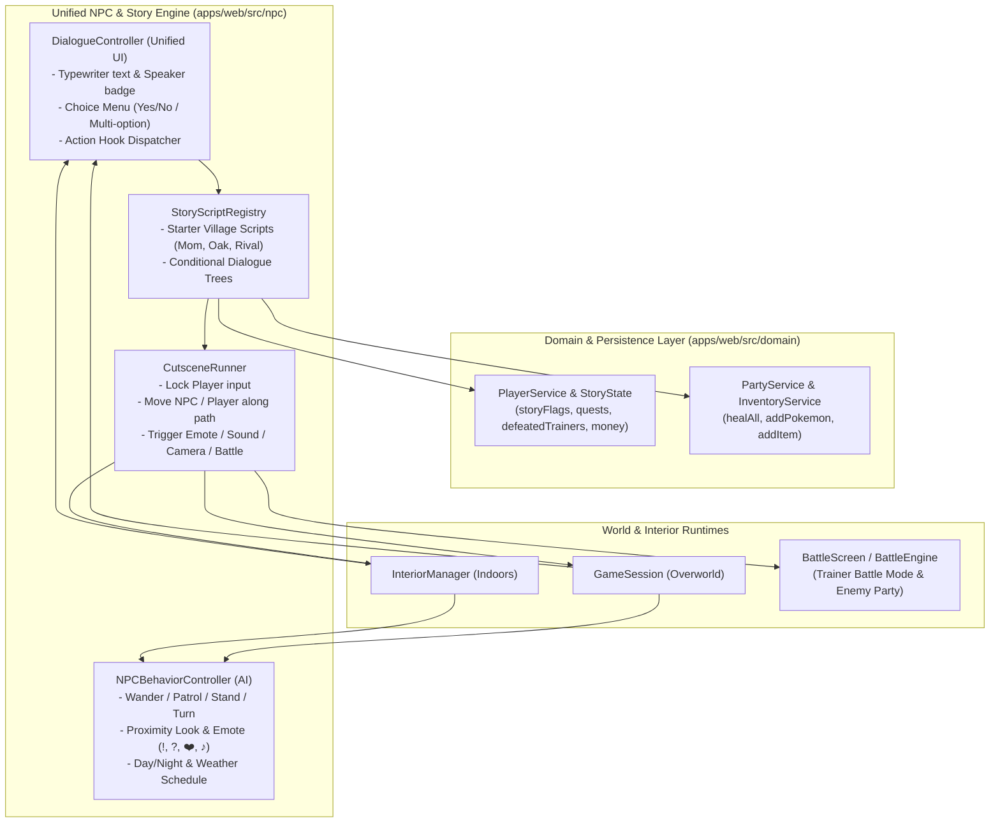

# BẢN THIẾT KẾ KIẾN TRÚC: HỆ THỐNG AI NPC, CỐT TRUYỆN & SỰ KIỆN TƯƠNG TÁC (NPC AI & STORY EVENT BLUEPRINT)

> **Mục tiêu tài liệu**: Thiết kế chi tiết kiến trúc nâng cấp thực thể NPC (cả ngoài Overworld lẫn trong phòng Interior) từ trạng thái đứng yên/xoay tại chỗ hiện tại thành **Hệ thống NPC Sống động (Living NPC AI)** có khả năng đi dạo/tuần tra, biểu cảm, phản ứng theo Ngày/Đêm & Thời tiết, kết nối trực tiếp với **Hệ thống Cờ Cốt truyện (Story Flags), Lựa chọn Hội thoại (Interactive Dialogue), Cắt cảnh (Cutscene Runner) và Đấu Huấn luyện viên (Trainer Battle)**.

---

## Mục Lục

1. [Đánh giá hiện trạng NPC vừa tích hợp trong Codebase](#1-đánh-giá-hiện-trạng-npc-vừa-tích-hợp-trong-codebase)
2. [Kiến trúc Tổng thể (System Architecture)](#2-kiến-trúc-tổng-thể-system-architecture)
3. [Module 1: Mô hình Thực thể NPC Hợp nhất & Hệ thống AI Hành vi (NPC AI & Schedule)](#3-module-1-mô-hình-thực-thể-npc-hợp-nhất--hệ-thống-ai-hành-vi-npc-ai--schedule)
   - [3.1. Cấu trúc dữ liệu `NPCEntity` & `NPCRuntimeState`](#31-cấu-trúc-dữ-liệu-npcentity--npcstate)
   - [3.2. Các chế độ di chuyển: `stand`, `turn_cycle`, `wander_box`, `patrol_path`](#32-các-chế-độ-di-chuyển-stand-turn_cycle-wander_box-patrol_path)
   - [3.3. Nhận thức không gian & Biểu cảm tự nhiên (Proximity Awareness & Emotes)](#33-nhận-thức-không-gian--biểu-cảm-tự-nhiên-proximity-awareness--emotes)
   - [3.4. Lịch trình theo Ngày/Đêm & Thời tiết (Day/Night & Weather Schedule)](#34-lịch-trình-theo-ngàyđêm--thời-tiết-daynight--weather-schedule)
   - [3.5. Đồng bộ Va chạm Động (Dynamic Tile Collision)](#35-đồng-bộ-va-chạm-động-dynamic-tile-collision)
4. [Module 2: Hệ thống Cờ Cốt truyện & Lưu trữ Tiến độ (Story Flags & Quest State)](#4-module-2-hệ-thống-cờ-cốt-truyện--lưu-trữ-tiến-độ-story-flags--quest-state)
   - [4.1. Mở rộng `PlayerProfile` và `SaveGameData`](#41-mở-rộng-playerprofile-và-savegamedata)
   - [4.2. Định nghĩa `StoryFlags` & `QuestStage` chuẩn](#42-định-nghĩa-storyflags--queststage-chuẩn)
   - [4.3. Phân nhánh Hội thoại theo Điều kiện (Conditional Dialogue Resolution)](#43-phân-nhánh-hội-thoại-theo-điều-kiện-conditional-dialogue-resolution)
5. [Module 3: Hộp thoại Tương tác & Hành động Sự kiện (Interactive Dialogue & Actions)](#5-module-3-hộp-thoại-tương-tác--hành-động-sự-kiện-interactive-dialogue--actions)
   - [5.1. Nâng cấp Hộp thoại DOM (`DialogueBoxController` dùng chung Overworld & Interior)](#51-nâng-cấp-hộp-thoại-dom-dialogueboxcontroller-dùng-chung-overworld--interior)
   - [5.2. Hệ thống Action Nguyên tử (`NPCEventAction`)](#52-hệ-thống-action-nguyên-tử-npceventaction)
6. [Module 4: Trình chạy Kịch bản Cắt cảnh (Cutscene Script Runner)](#6-module-4-trình-chạy-kịch-bản-cắt-cảnh-cutscene-script-runner)
   - [6.1. Cơ chế hoạt động của `CutsceneRunner`](#61-cơ-chế-hoạt-động-của-cutscenerunner)
   - [6.2. Tập lệnh Kịch bản (`CutsceneStep`)](#62-tập-lệnh-kịch-bản-cutscenestep)
7. [Module 5: Kết nối Đấu Huấn Luyện Viên (NPC Trainer Battle Integration)](#7-module-5-kết-nối-đấu-huấn-luyện-viên-npc-trainer-battle-integration)
   - [7.1. Cấu hình `TrainerProfile` trên NPC](#71-cấu-hình-trainerprofile-trên-npc)
   - [7.2. Mở rộng `BattleEngine` & `BattleScreen` cho Đội hình NPC (`enemyParty`)](#72-mở-rộng-battleengine--battlescreen-cho-đội-hình-npc-enemyparty)
8. [Module 6: Kịch bản Cốt truyện Mẫu tại Làng Khởi Đầu (Starter Village Storyline)](#8-module-6-kịch-bản-cốt-truyện-mẫu-tại-làng-khởi-đầu-starter-village-storyline)
9. [Lộ trình Triển khai (Implementation Phases)](#9-lộ-trình-triển-khai-implementation-phases)

---

## 1. Đánh giá chi tiết Bản mẫu (Prototype) NPC hiện tại trong Codebase

Qua kiểm tra trực tiếp 28 file ảnh sprite trong `apps/web/public/assets/characters/*.png` và đối chiếu với code trong `interior-manager.ts`, `character-renderer.ts`, `start-village.ts`, `settlement-sites.ts`, hiện trạng bản mẫu NPC có **5 điểm cốt lõi cần hoàn thiện**:

### 1.1. Lỗi hoạt ảnh đứng yên (giơ chân tại chỗ) trên Sprite Sheet 4x4
- Toàn bộ 27 sprite nhân vật (`oak.png`, `mama.png`, `rival_blue.png`, `asistente.png`, `cientifico.png`, `criador.png`, `gordo.png`, `old_man.png`, `bug_catcher.png`...) đều là **Walking Sheet 4x4 chuẩn (256x256px, mỗi frame 64x64px)**:
  - **Cột 0 & Cột 2 (`frame = 0, 2`)**: Tư thế đứng 2 chân chạm đất.
  - **Cột 1 (`frame = 1`)**: Tư thế **nhấc chân trái bước đi**.
  - **Cột 3 (`frame = 3`)**: Tư thế **nhấc chân phải bước đi**.
  - *(Riêng `nurse_joy.png`, cột 1–3 là hoạt ảnh cúi đầu chào).*
- **Vấn đề trong bản mẫu hiện tại**: Tại `character-renderer.ts` (L481–485) và `interior-manager.ts` (L414–417) đang viết:
  ```ts
  const cycle = Math.floor(state.animTimer / 700) % 8;
  state.frame = cycle === 0 ? 1 : 0;
  ```
  Điều này làm các NPC dù đang **đứng yên một chỗ** nhưng cứ mỗi vài giây lại **nhấc một chân lên không trung (`frame = 1`) rồi hạ xuống** như đang dậm chân tại chỗ.
- **Cách khắc phục chuẩn**: Khi đứng yên (`!isMoving`), NPC giữ nguyên `frame = 0` (tư thế đứng tự nhiên). Chỉ khi NPC thực sự bước đi từ ô này sang ô khác (`isMoving === true`) mới nội suy `frame = getStepFrame(stepCount, stepProgress)` luân phiên chân trái (`1`) — đứng (`0/2`) — chân phải (`3`).

### 1.2. Hành vi `'turn_random'` đã khai báo nhưng chưa được xử lý
- Trong `player-house-interior.ts` (L317), NPC **Mẹ (`char_mom`)** được khai báo `idleBehavior: 'turn_random'`, nhưng trong `interior-manager.ts` (L404) và `character-renderer.ts` (L471) mới chỉ viết nhánh `if (npc.idleBehavior === 'turn_cycle')` mà chưa có nhánh xử lý `'turn_random'`. Vì vậy Mẹ hiện đứng bất động nhìn một hướng duy nhất.

### 1.3. Mới sử dụng 8/28 Sprite nhân vật — Còn 20 nhân vật đã nạp vào `manifest.json` nhưng chưa xuất hiện
- **8 nhân vật đã đặt bản mẫu**:
  - Phòng Lab (`oak-lab-interior.ts`): `char_oak`, `char_asistente`, `char_cientifico`.
  - Nhà Player 1F (`player-house-interior.ts`): `char_mom`.
  - Sân Làng Khởi Đầu (`start-village.ts`): `char_tech_guy`, `char_flower_girl`, `char_farmer`, `char_sea_boy`.
- **20 nhân vật đã có trong `manifest.json` (L808–828) nhưng chưa được gắn vào thế giới**:
  - **Nhân vật cốt truyện & dân cư Làng Khởi Đầu**: `char_rival_blue` (Đối thủ Blue), `char_daisy_oak` (Chị của Blue), `char_old_man` (Ông cụ thông thái), `char_old_woman` (Bà cụ hiền từ).
  - **Nhân vật dịch vụ tại các Thị trấn (`settlement-sites.ts` hiện chưa sinh `npcs`!)**: `char_nurse_joy` + `healing_machine_balls` (Y tá PokéCenter), `char_mart_clerk_m` & `char_mart_clerk_f` (Nhân viên PokéMart), `char_officer_jenny` & `char_policeman` (Cảnh sát tuần tra thị trấn).
  - **Nhân vật Huấn luyện viên & Sự kiện theo Quần xã (Biomes)**:
    - `char_bug_catcher` (Đồng bằng Apricorn / Rừng rậm)
    - `char_fisherman` & `char_sailor` (Bờ biển / Hồ nước)
    - `char_hiker` (Đồi đá Rocky Highland / Vách núi)
    - `char_camper_m`, `char_picnicker_f`, `char_parasol_lady`, `char_school_kid_m`, `char_school_kid_f` (Đồng cỏ / Đường mòn / Rừng mùa thu)
    - `char_rocket_grunt_m` & `char_rocket_grunt_f` (Đội Tên Lửa tại các sự kiện cốt truyện / Vùng Đất Tối)

### 1.4. Logic cập nhật NPC ngoài Overworld đang đặt tạm trong hàm Render
- Trong `character-renderer.ts` (L470–485), bộ đếm thời gian hành vi của NPC ngoài trời đang được cộng trực tiếp bên trong `collectVillageNPCs()` (hàm vẽ mỗi frame) và chưa có bước cập nhật vị trí thực tế trong `GameSession.update()`.
- Các thị trấn phụ (`constructVillage` trong `settlement-sites.ts` và `village-rules.ts`) chưa khởi tạo mảng `npcs`.

### 1.5. Hội thoại & Tương tác mới chỉ dừng ở mảng chuỗi tĩnh (`dialogue: string[]`)
- Chưa kết nối với hành động thực tế (ví dụ: câu cuối của Mẹ ở `player-house-interior.ts` L315 nói *"Đội hình Pokémon của con đã được Mẹ chăm sóc và hồi phục đầy đủ năng lượng!"*, nhưng chưa gọi `partyService.healAll()`).
- Chưa có biến trạng thái cốt truyện (`storyFlags`), lựa chọn `Yes/No`, biểu cảm trên đầu NPC (`!`, `?`, `❤️`, `♪`), hay kịch bản di chuyển NPC.

---

## 2. Kiến trúc Tổng thể (System Architecture)



---

## 3. Module 1: Mô hình Thực thể NPC Hợp nhất & Hệ thống AI Hành vi (NPC AI & Schedule)

### 3.1. Cấu trúc dữ liệu `NPCEntity` & `NPCRuntimeState`
Thay vì tách rời `InteriorNPC` và `VillageNPCEntity` với ít trường, ta chuẩn hóa thành interface mở rộng tương thích ngược 100% với cấu hình hiện có:

```ts
export type NPCMovementMode =
  | 'stand'          // Đứng yên 1 hướng
  | 'turn_random'    // Đứng tại chỗ, thỉnh thoảng nhìn ngẫu nhiên
  | 'turn_cycle'     // Đứng tại chỗ, xoay hướng theo mảng turnCycle
  | 'wander_box'     // Đi dạo ngẫu nhiên trong phạm vi wanderRadius quanh (homeGX, homeGY)
  | 'patrol_path';   // Đi tuần tra tuần tự qua danh sách tọa độ waypoints

export type NPCEmoteType =
  | '!' | '?' | 'sweat' | 'dots' | 'heart' | 'music' | 'anger' | 'happy' | 'talk';

export interface NPCScheduleRule {
  /** Khung giờ áp dụng (ví dụ: ['morning', 'day', 'dusk'] hoặc ['night']) */
  timeBands?: Array<'morning' | 'day' | 'dusk' | 'night'>;
  /** Thời tiết áp dụng (ví dụ: ['rain', 'heavy_rain', 'thunderstorm']) */
  weathers?: string[];
  /** Nếu false, NPC ẩn đi (ví dụ ban đêm đã vào trong nhà ngủ) */
  visible?: boolean;
  /** Ghi đè vị trí neo và hành vi theo khung giờ/thời tiết */
  homeGX?: number;
  homeGY?: number;
  direction?: 0 | 1 | 2 | 3;
  movementMode?: NPCMovementMode;
  wanderRadius?: number;
  dialogueOverride?: string[];
}

export interface NPCDefinition {
  id: string;
  name: string;
  spriteKey: string;
  gx: number;
  gy: number;
  direction: 0 | 1 | 2 | 3;
  initialDirection?: 0 | 1 | 2 | 3;
  role?: 'villager' | 'story' | 'healer' | 'merchant' | 'breeder' | 'trainer' | 'oak' | 'rival';

  // Cấu hình AI di chuyển & hành vi
  idleBehavior?: NPCMovementMode;
  turnCycle?: Array<0 | 1 | 2 | 3>;
  turnIntervalMs?: number;
  wanderRadius?: number;                        // Bán kính đi dạo quanh (homeGX, homeGY), mặc định 2–3 ô
  patrolWaypoints?: Array<{ gx: number; gy: number; waitMs?: number }>;
  moveSpeedPx?: number;                         // Mặc định 1.25 px/frame (đi bộ thư thái)
  lookAtPlayerRadius?: number;                  // Khoảng cách tự quay mặt nhìn khi Player đi sát (ví dụ 2 ô)
  ambientEmotePool?: NPCEmoteType[];            // Biểu cảm tự nhiên khi nhàn rỗi (ví dụ ['music', 'happy'])

  // Lịch trình Ngày/Đêm & Thời tiết
  schedule?: NPCScheduleRule[];

  // Hội thoại mặc định & Liên kết kịch bản sự kiện
  dialogue: string[];
  scriptId?: string;                            // ID kịch bản trong StoryScriptRegistry (nếu có)
  trainerId?: string;                           // ID cấu hình Trainer Battle (nếu là NPC đấu bài)
}
```

Trạng thái thực thi động (`NPCRuntimeState`) được quản lý tập trung bởi `NPCBehaviorController`:
```ts
export interface NPCRuntimeState {
  id: string;
  homeGX: number;
  homeGY: number;
  gx: number;
  gy: number;
  fromGX: number;
  fromGY: number;
  toGX: number;
  toGY: number;
  x: number;              // Pixel X nội suy mượt: gx * 32 - 16
  y: number;              // Pixel Y nội suy mượt: gy * 32 - 32
  direction: 0 | 1 | 2 | 3;
  isMoving: boolean;
  stepProgress: number;   // 0.0 -> 1.0
  stepCount: number;      // Đếm bước chân để lấy frame chân trái/phải chuẩn GBA (getStepFrame)
  frame: 0 | 1 | 2 | 3;
  animTimer: number;
  behaviorTimer: number;
  nextDecisionDelayMs: number;
  cycleIndex: number;
  waypointIndex: number;
  visible: boolean;
  emote: { type: NPCEmoteType; timer: number; maxTime: number } | null;
  // Hàng đợi bước đi phục vụ Cutscene Script
  scriptedPathQueue: Array<{ gx: number; gy: number; faceDir?: 0 | 1 | 2 | 3 }>;
}
```

---

### 3.2. Các chế độ di chuyển: `stand`, `turn_cycle`, `wander_box`, `patrol_path`

1. **`wander_box` (Đi dạo tự nhiên quanh vùng neo)**:
   - Mỗi `2500ms – 4500ms` (ngẫu nhiên để các NPC không bước đồng loạt như robot), NPC quyết định:
     - `65%` cơ hội bước 1 ô theo hướng ngẫu nhiên nằm trong hình vuông `|nextGX - homeGX| <= wanderRadius` và `|nextGY - homeGY| <= wanderRadius`.
     - `35%` cơ hội chỉ đổi hướng nhìn tại chỗ và hiện biểu cảm nhẹ (như `♪` cho Cô Gái Yêu Hoa, `🍃` cho Bác Nông Dân).
   - **Kiểm tra hợp lệ trước khi bước (`canNPCMoveTo(nextGX, nextGY)`)**:
     - Không bước vào ô của `Player` hoặc `Follower`.
     - Không bước vào ô của `NPC` khác hoặc `WildPokemon`.
     - Không bước ra khỏi mặt đường/cỏ phẳng của làng (không nhảy xuống vách núi, không lội xuống nước, không bước đè lên mặt trước cửa nhà `doorGX, doorGY + 1` để tránh chặn cửa ra vào của người chơi!).
2. **`patrol_path` (Đi tuần tra theo lộ trình)**:
   - Phù hợp cho **Bác Nông Dân** đi dọc hàng rào chuồng trại, **Trợ lý Giáo sư** đi lại giữa kệ sách và bàn máy tính, hoặc **Cảnh sát / Tuần tra viên** đi dọc đại lộ làng.
   - Khi đến một `waypoint`, NPC dừng lại `waitMs` (ví dụ `3000ms`), xoay hướng kiểm tra rồi đi tiếp tới `waypoint` kế tiếp. Nếu bị Player đứng chắn đường, NPC tạm dừng chờ và tự quay mặt nhìn Player cho tới khi đường thông.

---

### 3.3. Nhận thức không gian & Biểu cảm tự nhiên (Proximity Awareness & Emotes)

1. **Phản ứng khi Player lại gần (`lookAtPlayerRadius`)**:
   - Khi Player đi vào bán kính $\le 2$ ô quanh một NPC đang đứng nghỉ (và NPC không bận chạy Cutscene):
     - NPC có thể khẽ xoay mặt hướng về phía Player để thể hiện sự chú ý sống động.
     - Nếu NPC có nhiệm vụ/sự kiện mới chưa hoàn thành (kiểm tra qua `StoryScriptRegistry`), NPC tự động bật bong bóng biểu cảm **`!`** hoặc **`💬`** trên đầu khi Player đi ngang qua để gợi ý người chơi lại bắt chuyện!
2. **Biểu cảm môi trường (`ambientEmotePool`)**:
   - Tái sử dụng và nâng cấp hàm `drawEmoteBubble()` trong [`character-renderer.ts`](file:///e:/Pokemon/apps/web/src/rendering/character-renderer.ts#L359-L432) cho cả NPC ngoài trời và trong nhà:
     - `Cô Gái Yêu Hoa`: thỉnh thoảng hiện `♪` hoặc `❤️` khi đứng cạnh luống hoa.
     - `Bác Nông Dân`: thỉnh thoảng hiện `✨` hoặc `💧` khi chăm sóc đồng cỏ.
     - `Kỹ Sư Nghiên Cứu`: thỉnh thoảng hiện `?` hoặc `💬` khi đọc số liệu trước siêu máy tính.

---

### 3.4. Lịch trình theo Ngày/Đêm & Thời tiết (Day/Night & Weather Schedule)

Kết nối trực tiếp với `worldClock` (`getDayPhase()`) và `getWeather()` trong `GameSession`:
- **Ban ngày (`morning`, `day`) & Trời quang (`clear`)**:
  - Các NPC dân làng (`npc_flower_girl`, `npc_farmer`, `npc_tech_guy`, `npc_sea_boy`) hoạt động sôi nổi ở chế độ `wander_box` / `patrol_path`.
- **Chiều tà (`dusk`)**:
  - Tần suất đi lại chậm hơn, câu thoại đầu tiên có thể phản ánh buổi hoàng hôn.
- **Ban đêm (`night`) hoặc Trời mưa bão (`rain`, `heavy_rain`, `thunderstorm`)**:
  - Dân làng ngoài trời có thể chuyển sang đứng trú mưa dưới mái hiên gần nhà (`homeGX, homeGY` sát hiên nhà) hoặc ẩn đi (`visible: false` — đã về nhà nghỉ ngơi), trừ những NPC đặc thù ban đêm (như `char_policeman` / `char_officer_jenny` đi tuần đêm với câu thoại riêng!).

---

### 3.5. Đồng bộ Va chạm Động (Dynamic Tile Collision)

- **Hiện trạng**:
  - Trong `chunk-objects.ts` (L870–878), collider của NPC đang được đẩy cứng vào `chunk.colliders` lúc khởi tạo chunk.
  - Trong `interior-manager.ts` (L346–348), ô của NPC được thêm cứng vào `this.solidTiles` lúc vào phòng.
- **Cơ chế mới khi NPC di chuyển**:
  - Khi NPC đang bước từ `(fromGX, fromGY)` sang `(toGX, toGY)`, **cả hai ô** `(fromGX, fromGY)` và `(toGX, toGY)` đều được đánh dấu chiếm chỗ tạm thời để Player không bước xuyên qua người NPC đang đi.
  - Ngay khi `stepProgress >= 1.0`, giải phóng `(fromGX, fromGY)` và chỉ giữ va chạm tại `(toGX, toGY)`.

---

## 4. Module 2: Hệ thống Cờ Cốt truyện & Lưu trữ Tiến độ (Story Flags & Quest State)

### 4.1. Mở rộng `PlayerProfile` và `SaveGameData`
Trong [`apps/web/src/domain/player/player-state.ts`](file:///e:/Pokemon/apps/web/src/domain/player/player-state.ts), bổ sung các trường lưu trữ cốt truyện vào `PlayerProfile` (tự động tương thích ngược với file save cũ nhờ giá trị mặc định `{}`):

```ts
export interface QuestProgress {
  id: string;
  title: string;
  stage: number;          // 0 = chưa nhận, 1..N = các bước, 99 = hoàn thành
  completed: boolean;
  updatedAt: number;
}

export interface PlayerProfile {
  // ... các trường hiện có (id, name, gender, money, badges, inventory, position)
  storyFlags?: Record<string, boolean | number | string>;
  quests?: Record<string, QuestProgress>;
  defeatedTrainers?: Record<string, number>; // trainerId -> timestamp hoặc số lần thắng
}
```

Cung cấp các phương thức tiện ích trên `playerService`:
- `getFlag(key: string): boolean | number | string | undefined`
- `setFlag(key: string, value?: boolean | number | string): void`
- `getQuestStage(questId: string): number`
- `advanceQuest(questId: string, stage: number, title?: string, completed?: boolean): void`
- `isTrainerDefeated(trainerId: string): boolean`
- `markTrainerDefeated(trainerId: string): void`

---

### 4.2. Định nghĩa `StoryFlags` & `QuestStage` chuẩn

Ví dụ bộ cờ cốt truyện cho chương mở đầu tại **Làng Khởi Đầu (Starter Village)**:
- `story.talked_to_mom`: Đã nói chuyện với Mẹ ở tầng 1 trước khi ra khỏi nhà.
- `story.met_oak_in_lab`: Đã gặp Giáo sư Oak trong Viện Nghiên Cứu.
- `story.received_pokedex`: Đã nhận Pokédex và 5 quả Pokéball khuyến khích từ Giáo sư Oak.
- `story.starter_chosen`: Loài Pokémon khởi đầu đã chọn (`'BULBASAUR' | 'CHARMANDER' | 'SQUIRTLE'`) hoặc nhận thêm từ Giáo sư.
- `story.rival_battle_1_won`: Đã đấu thắng trận giao hữu đầu tiên với Rival Blue.
- `story.ranch_egg_received`: Đã nhận Trứng Pokémon hiếm / quà từ Bác Nông Dân ở trang trại chăn nuôi.

---

### 4.3. Phân nhánh Hội thoại theo Điều kiện (Conditional Dialogue Resolution)

Mỗi NPC có thể khai báo một danh sách các nhánh hội thoại (`NPCDialogueBranch[]`). Khi người chơi tương tác, hệ thống duyệt từ trên xuống dưới và chọn **nhánh đầu tiên thỏa mãn điều kiện (`condition`)**:

```ts
export interface StoryCondition {
  allFlags?: string[];                      // Tất cả các cờ này phải === true
  noFlags?: string[];                       // Tất cả các cờ này phải chưa bật
  questStage?: { id: string; eq?: number; gte?: number; lte?: number };
  timeBands?: Array<'morning' | 'day' | 'dusk' | 'night'>;
  weathers?: string[];
  minPartyCount?: number;
  minBadges?: number;
}
```

---

## 5. Module 3: Hộp thoại Tương tác & Hành động Sự kiện (Interactive Dialogue & Actions)

### 5.1. Nâng cấp Hộp thoại DOM (`DialogueBoxController` dùng chung Overworld & Interior)
Hợp nhất hộp thoại của `InteriorManager` và `GameSession` thành một controller dùng chung hỗ trợ:
1. **Hiệu ứng chữ chạy (Typewriter Effect)**:
   - Chữ hiện mượt từng ký tự kèm âm thanh blip nhẹ; bấm `Space` / Click lần 1 khi chữ đang chạy sẽ hiện toàn bộ câu ngay lập tức; bấm lần 2 sẽ qua câu tiếp theo.
2. **Menu Lựa chọn (`DialogueChoice`)**:
   - Khi một nút hội thoại có `choices: Array<{ label: string; nextBranchId?: string; actions?: NPCEventAction[] }>`, hộp thoại hiển thị bảng chọn góc phải trên hộp thoại (điều khiển bằng phím mũi tên `W/S` hoặc `Up/Down` + `Space` hoặc Click chuột).
   - Ví dụ:
     - Mẹ: *"Con có muốn nghỉ ngơi một lát để Mẹ chăm sóc cho các Pokémon không?"* $\rightarrow$ `[Nghỉ ngơi ngay]` / `[Con vẫn khỏe]`.
     - Giáo sư Oak: *"Cháu muốn nhận người bạn đồng hành nào?"* $\rightarrow$ `[Bulbasaur (Hệ Cỏ)]` / `[Charmander (Hệ Lửa)]` / `[Squirtle (Hệ Nước)]`.

---

### 5.2. Hệ thống Action Nguyên tử (`NPCEventAction`)

Sau một câu thoại hoặc khi chọn một phương án trả lời, NPC có thể thực thi một chuỗi các Action:

| Loại Action (`type`) | Tham số | Công năng thực tế |
|---|---|---|
| `HEAL_PARTY` | `{ playJingle?: boolean; showToast?: boolean }` | Gọi `partyService.healAll()`, phát âm thanh hồi phục và làm sáng nhân vật. Dùng cho **Mẹ** và **Y tá Joy**. |
| `GIVE_ITEM` | `{ itemId: string; count: number }` | Gọi `playerService.addItem(itemId, count)`, hiện thông báo *"Nhận được 5 x Poké Ball!"* kèm âm thanh nhận đồ. |
| `GIVE_POKEMON` | `{ speciesKey: string; level: number; isShiny?: boolean; heldItem?: string }` | Tạo Pokémon bằng `createPartyPokemon()` và thêm vào Đội hình (hoặc PC nếu đầy). |
| `GIVE_MONEY` / `TAKE_MONEY` | `{ amount: number }` | Cộng/trừ PokéDollar qua `playerService.addMoney()` / `spendMoney()`. |
| `SET_FLAG` | `{ flag: string; value: boolean \| number \| string }` | Lưu cờ cốt truyện vào `playerService`. |
| `ADVANCE_QUEST` | `{ questId: string; stage: number; title?: string; completed?: boolean }` | Cập nhật tiến độ nhiệm vụ và hiện thông báo nhiệm vụ trên màn hình. |
| `START_TRAINER_BATTLE` | `{ trainerId: string; onWinBranch?: string; onLoseBranch?: string }` | Chuyển vào trận đấu Huấn luyện viên với đội hình của NPC; sau khi thắng tự động chạy nhánh thoại sau trận và trao thưởng. |
| `RUN_CUTSCENE` | `{ cutsceneId: string }` | Khởi chạy một kịch bản cắt cảnh (NPC bước đi, biểu cảm, chuyển góc máy). |
| `OPEN_UI` | `{ screen: 'shop' \| 'daycare' \| 'pc' \| 'pokedex' }` | Mở giao diện Cửa hàng PokéMart, Trại Chăn Nuôi (Daycare), PC hoặc Pokédex. |

---

## 6. Module 4: Trình chạy Kịch bản Cắt cảnh (Cutscene Script Runner)

### 6.1. Cơ chế hoạt động của `CutsceneRunner`
Khi một sự kiện cốt truyện kích hoạt (do người chơi nói chuyện với NPC hoặc bước vào một **Ô Kích Hoạt / Trigger Zone** như lần đầu bước vào Viện Nghiên Cứu hoặc định bước ra khỏi làng khi chưa gặp Giáo sư Oak):
1. `CutsceneRunner.isPlaying = true` $\rightarrow$ Khóa tạm thời điều khiển bàn phím của người chơi (nhưng vòng lặp render và animation bước chân vẫn chạy bình thường).
2. Thực thi tuần tự từng bước `CutsceneStep` bằng `async / Promise` hoặc máy trạng thái (State Machine).
3. Khi hoàn tất bước cuối cùng, mở khóa bàn phím và lưu tự động qua `autosaveCoordinator`.

### 6.2. Tập lệnh Kịch bản (`CutsceneStep`)

```ts
export type CutsceneStep =
  | { type: 'WAIT'; durationMs: number }
  | { type: 'EMOTE'; target: 'player' | string; emote: NPCEmoteType; durationMs?: number }
  | { type: 'FACE'; target: 'player' | string; direction: 0 | 1 | 2 | 3 }
  | { type: 'MOVE_STEPS'; target: 'player' | string; steps: Array<0 | 1 | 2 | 3>; speedPx?: number }
  | { type: 'MOVE_TO_TILE'; target: 'player' | string; gx: number; gy: number; endDir?: 0 | 1 | 2 | 3 }
  | { type: 'DIALOGUE'; speaker: string; lines: string[] }
  | { type: 'PLAY_SE'; soundPath: string; volume?: number }
  | { type: 'CAMERA_PAN'; targetGX: number; targetGY: number; durationMs: number }
  | { type: 'CAMERA_RESET' }
  | { type: 'ACTION'; action: NPCEventAction };
```

---

## 7. Module 5: Kết nối Đấu Huấn Luyện Viên (NPC Trainer Battle Integration)

### 7.1. Cấu hình `TrainerProfile` trên NPC
Tạo danh mục `TRAINER_DB` (`apps/web/src/npc/trainer-registry.ts`) định nghĩa đội hình và phần thưởng cho các NPC Huấn luyện viên (như `rival_blue_1`, `bug_catcher_leo`, `camper_liam`, `rocket_grunt_1`...):

```ts
export interface TrainerPokemonSpec {
  speciesKey: string;
  level: number;
  moves?: string[];
  ability?: string;
  heldItem?: string;
  ivs?: Partial<PokemonStatValues> | 'perfect';
  nature?: NatureName;
  isShiny?: boolean;
}

export interface TrainerProfile {
  id: string;
  name: string;
  title: string;              // Ví dụ: "Đối Thủ Truyền Kiếp", "Cậu Bé Bắt Bọ", "Đội Tên Lửa"
  spriteKey: string;
  prizeMoney: number;         // Tiền thưởng khi đánh bại
  items?: string[];           // Vật phẩm AI có thể dùng trong trận (ví dụ ['POTION'])
  party: TrainerPokemonSpec[];
  introDialogue: string[];    // Thoại trước khi vào trận
  defeatDialogue: string[];   // Thoại ngay khi Pokémon cuối cùng của NPC ngất xỉu
  postBattleDialogue: string[]; // Thoại khi nói chuyện lại sau trận đấu
}
```

### 7.2. Mở rộng `BattleEngine` & `BattleScreen` cho Đội hình NPC (`enemyParty`)
1. **Truyền `enemyParty: BattlerPokemon[]` vào `BattleScreen` và `BattleEngine`**:
   - Khi `isWild === false`:
     - **Cấm tung Pokéball**: Nếu người chơi chọn dùng bóng trong túi, hiển thị thông báo *"Huấn luyện viên đối phương đã đánh bật quả bóng ra! Không thể bắt Pokémon của người khác!"* (không làm mất bóng).
     - **Cấm Bỏ chạy (`tryFlee`)**: Hiển thị *"Không thể bỏ chạy khỏi trận đấu với Huấn luyện viên!"*.
     - **Đổi Pokémon tiếp theo khi ngất**: Khi `enemyPokemon.isFainted === true`, kiểm tra trong `enemyParty` còn Pokémon nào có `currentHp > 0` không. Nếu còn, NPC tung con tiếp theo ra sân, kích hoạt `AbilityEngine.onSwitchIn()` và `applyEntryHazards()` (giúp `Stealth Rock`, `Spikes`, `Toxic Spikes`, `Sticky Web`, `Roar`, `Whirlwind`, `Dragon Tail` hoạt động đầy đủ 100%).
     - **Hiển thị thanh bóng đội hình đối thủ (Enemy Party Ball HUD)**: Vẽ hàng 6 chấm Pokéball nhỏ trên thanh máu đối thủ (Đỏ = còn sống, Xám = đã ngất, Trống = không có).
     - **Trao thưởng sau trận**: Cộng `prizeMoney` vào `playerService.addMoney()`, đánh dấu `playerService.markTrainerDefeated(trainer.id)` và gọi nhánh thoại sau trận.

---

## 8. Module 6: Kịch bản Cốt truyện Mẫu tại Làng Khởi Đầu (Starter Village Storyline)

Khi hệ thống được triển khai, toàn bộ NPC tại Làng Khởi Đầu sẽ kết nối thành một mạch trải nghiệm liền mạch:

1. **Tại Nhà Player Tầng 1 (`char_mom` — Mẹ)**:
   - **Lần đầu nói chuyện**: Mẹ dặn dò con đến gặp Giáo sư Oak ở Viện Nghiên Cứu, tặng con `5 x Potion` làm hành trang (`GIVE_ITEM` + `SET_FLAG: 'story.talked_to_mom'`).
   - **Những lần về thăm nhà sau**: Mẹ hỏi thăm, cho phép chọn `[Nghỉ ngơi & Hồi phục]` $\rightarrow$ gọi `HEAL_PARTY` hồi đầy 100% HP, PP và xóa Status cho toàn bộ đội hình!
2. **Tại Viện Nghiên Cứu Giáo Sư Oak (`prof_oak` & `rival_blue`)**:
   - **Bổ sung NPC `rival_blue` (Đối thủ Blue)** đứng cạnh bàn nghiên cứu trong Viện Nghiên Cứu (`oak-lab-interior.ts`).
   - **Khi nói chuyện với Giáo sư Oak lần đầu**:
     - Giáo sư giới thiệu về thế giới Pokémon, trao nhiệm vụ hoàn thiện Pokédex, tặng `10 x Poké Ball` + cho phép nhận thêm 1 Pokémon Khởi Đầu (Bulbasaur / Charmander / Squirtle) nếu người chơi chưa nhận (`story.met_oak_in_lab = true`).
   - **Khi nói chuyện với Rival Blue (hoặc khi định rời phòng Lab sau khi gặp Giáo sư)**:
     - Blue hiện biểu cảm `!`, bước tới trước mặt Player (`CutsceneRunner`) và thách đấu trận mở màn (`START_TRAINER_BATTLE` với đội hình 2 Pokémon cấp 5).
     - Thắng trận nhận `+500 PokéDollar`, mở khóa cờ `story.rival_battle_1_won = true`.
3. **Tại Khu Trang Trại Chăn Nuôi ngoài làng (`npc_farmer` — Bác Nông Dân)**:
   - Ban ngày đi tuần (`patrol_path`) quanh chuồng trại và ruộng lúa.
   - Sau khi người chơi đã thắng Rival Blue (`story.rival_battle_1_won`), nói chuyện với Bác Nông Dân sẽ được bác tặng 1 vật phẩm chăn nuôi/quả Berry quý và mở giao diện gửi Pokémon hoặc nhận nhiệm vụ phụ.
4. **Dân làng & Huấn luyện viên quanh làng (`npc_tech_guy`, `npc_flower_girl`, `npc_sea_boy`, `char_bug_catcher`)**:
   - Đi dạo tự nhiên (`wander_box`), hiện biểu cảm (`♪`, `❤️`, `✨`), tự quay mặt nhìn khi Player đi gần, và thay đổi câu thoại theo buổi Sáng / Ngày / Đêm / Trời mưa.

---

## 9. Lộ trình Triển khai (Implementation Phases)

Để đảm bảo code sạch, không phá vỡ các test hiện có và dễ kiểm tra từng bước, quá trình code sẽ chia làm **3 Bước (Sub-phases)**:

### Bước 1: Core NPC AI (Di chuyển mượt, Biểu cảm, Lịch trình Ngày/Đêm & Va chạm động)
- Tạo `apps/web/src/npc/npc-types.ts` và `apps/web/src/npc/npc-behavior-controller.ts`.
- Tích hợp `wander_box`, `patrol_path`, `lookAtPlayer`, `emote` (`!`, `?`, `♪`, `❤️`, `💬`) và `schedule` (Ngày/Đêm/Thời tiết) cho cả NPC ngoài Overworld (`GameSession` + `CharacterRenderer`) lẫn NPC trong nhà (`InteriorManager`).
- Cập nhật kiểm tra va chạm động (`isWalkable`) để NPC đi lại mượt mà, không đi xuyên tường/cửa hay đè lên người chơi.

### Bước 2: Story Flag, Hộp thoại Lựa chọn (Choice UI), Action Dispatcher & Cutscene Runner
- Mở rộng `PlayerProfile` (`storyFlags`, `quests`, `defeatedTrainers`) trong `player-state.ts` & `player-service.ts`.
- Tạo `apps/web/src/npc/dialogue-controller.ts` (Hiệu ứng chữ chạy, Menu lựa chọn `Yes/No` & đa phương án, thực thi `HEAL_PARTY`, `GIVE_ITEM`, `GIVE_POKEMON`, `SET_FLAG`, `ADVANCE_QUEST`).
- Tạo `apps/web/src/npc/cutscene-runner.ts` hỗ trợ di chuyển NPC/Player theo kịch bản và hiện biểu cảm.

### Bước 3: Trainer Battle (`enemyParty`) & Kịch bản Cốt truyện Làng Khởi Đầu
- Nâng cấp `BattleEngine` & `BattleScreen` hỗ trợ đội hình nhiều Pokémon của NPC (`enemyParty`), chặn bắt/chặn chạy trong đấu Trainer, hiển thị số bóng của NPC và trao tiền thưởng.
- Kết nối kịch bản đầy đủ cho **Mẹ (hồi máu thật + tặng quà)**, **Giáo sư Oak (trao quà + Starter/Pokédex)**, **Rival Blue (cắt cảnh + đấu Trainer)** và **các NPC Làng Khởi Đầu**.
